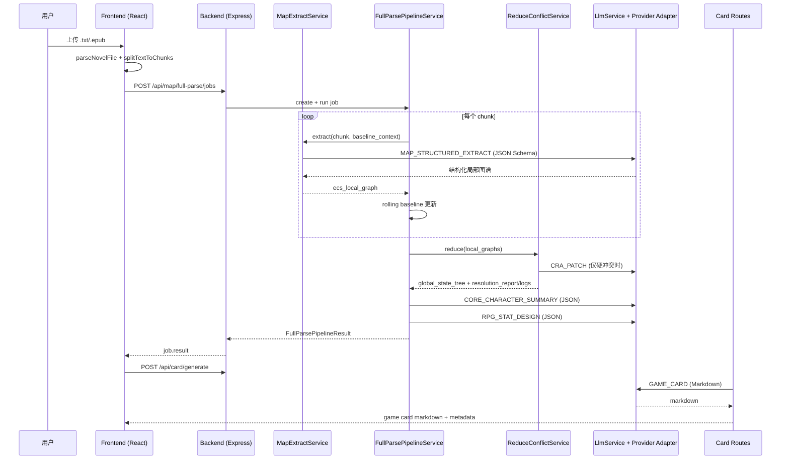

# 上传文本 -> Map-Reduce -> Game Card 生成：全链路技术说明

> 文档目标：把当前代码中的真实链路、JSON 契约、提示词与容错逻辑一次讲清，便于后续协作、排障和扩展。
> 代码基线：`.`（2026-03-20）

## 1. 总览（从前端上传到游戏卡产出）



---

## 2. 前端入口：上传与切片

### 2.1 文件解析
- 入口：`./frontend/src/App.tsx` `onUploadFile`
- 解析器：`./frontend/src/utils/novelParser.ts`

支持格式：
- `.txt`（自动编码探测：`utf-8`/`gb18030`/`utf-16le`/`utf-16be`/`big5`，并按乱码评分挑最优）
- `.epub`（解压后提取 html/xhtml 文本）

### 2.2 切片
- 函数：`splitTextToChunks(rawText, maxChunkLength)`
- 默认切片长度：`2500`
- UI 可调范围：`1200 ~ 40000`，步长 `100`
- 逻辑：按段落聚合，超过阈值再硬切。

前端状态产物：
- `allChunks: string[]`
- `sourceFileName: string`
- `totalChunkChars: number`

---

## 3. 一键全局解析（异步 Job 模式）

### 3.1 前端调用
- 方法：`apiManager.createFullParseJob(...)`
- 路由：`POST /api/map/full-parse/jobs`
- 文件：`./frontend/src/services/apiManager.ts`

请求体：
```json
{
  "chunks": ["chunk1", "chunk2", "..."],
  "baseline_context": "可选",
  "chunk_id_prefix": "文件名或前缀",
  "start_chapter_index": 1
}
```

### 3.2 轮询与暂停恢复
- 查询：`GET /api/map/full-parse/jobs/:jobId`
- 暂停：`POST /api/map/full-parse/jobs/:jobId/pause`
- 恢复：`POST /api/map/full-parse/jobs/:jobId/resume`

Job 状态：
- `PENDING | RUNNING | PAUSED | SUCCEEDED | FAILED`

Progress 结构：
```json
{
  "stage": "MAP|REDUCE|PAUSED|DONE|FAILED",
  "total_chunks": 199,
  "mapped_chunks": 87,
  "failed_chunks": 2,
  "current_chunk_index": 88,
  "current_chapter_index": 88,
  "percentage": 44,
  "message": "Map 进度 88/199"
}
```

### 3.3 限制与保护
- 前端预估请求体 > 19MB 会提前拦截。
- 后端 `express.json` 默认限制：`REQUEST_BODY_LIMIT`（默认 `20mb`）。
- 切片数量上限：`MAX_FULL_PARSE_CHUNKS`（默认 `1200`）。

代码位置：
- `frontend/src/App.tsx` `onMapBatch` / `pollFullParseJobUntilStop`
- `backend/src/app.ts`
- `backend/src/routes/map-routes.ts`

---

## 4. Map 阶段：每个切片的结构化提取

### 4.1 接口
- `POST /api/map/extract`
- 入参：
```json
{
  "chunk_id": "xxx-chunk-12",
  "chapter_index": 12,
  "chunk_text": "...",
  "baseline_context": "..."
}
```

- 出参：
```json
{
  "ok": true,
  "ecs_local_graph": {
    "chunk_id": "...",
    "chapter_index": 12,
    "entities": [],
    "assertions": [],
    "implicit_rules": {
      "social_power_relations": [],
      "ability_costs": [],
      "causal_invariants": []
    },
    "metadata": {}
  }
}
```

### 4.2 LLM 调用（主路径）
- 服务：`MapExtractService.extract`
- 任务：`MAP_STRUCTURED_EXTRACT`
- Temperature：`0.2`
- Gemini Structured Output：
  - `responseMimeType = application/json`
  - `responseSchema = MAP_STRUCTURED_EXTRACT_SCHEMA`

提示词来源：
- 系统提示词：`MAP_STRUCTURED_EXTRACTION_SYSTEM_PROMPT`
- 用户提示词：`generateMapExtractionPrompt(chunkId, baselineContext, chunkText)`

文件：
- `./backend/src/services/map-extract-service.ts`
- `./backend/src/services/llm/llm-spec-center.ts`
- `./backend/src/services/llm/adapters/geminiAdapter.ts`

### 4.3 结构化结果归一化
核心规则：
- 低置信过滤阈值：`confidence < 0.6` 丢弃。
- `entity_updates` -> `EcsEntity` + FACT/规则类 `EcsAssertion`
- `relational_edges` -> 关系断言（`relation_to_xxx`）
- `implicit_rules` -> 三类规则数组 + 世界断言
- 必保留 `world` 实体

### 4.4 缓存与回退
- Map 缓存键：`sha256(normalized chunk text)`
- 缓存开关：`MAP_CACHE_ENABLED`（默认开启）
- 容量：`MAP_CACHE_MAX_ENTRIES`（默认 `2000`）
- 缓存命中会重写 `chapter_index/chunk_id` 并标记 `metadata.cache_hit`

失败回退链：
1. 结构化抽取失败 -> 尝试 legacy 双流（事件 + 隐性规则）
2. legacy 仍失败 -> 最小兜底图谱（仅 world + `chunk_brief_summary`）

---

## 5. Full Parse Pipeline：Map -> Reduce -> RPG enrich

服务：`FullParsePipelineService.execute`

执行顺序：
1. 逐切片 Map（可 pause）
2. rolling baseline 更新（摘要 + 规则 + FACT）
3. Reduce 冲突仲裁
4. 全局树 enrich：核心角色 summary + RPG 数值体系

pipeline_report：
```json
{
  "mapped_chunks": 199,
  "failed_chunks": 3,
  "start_chapter_index": 1,
  "end_chapter_index": 199,
  "baseline_strategy": "ROLLING_SUMMARY"
}
```

---

## 6. Reduce 阶段：4 级“吃书”冲突仲裁

接口：`POST /api/reduce/conflict`

入参：
```json
{
  "local_graphs": [
    {
      "chunk_id": "...",
      "chapter_index": 1,
      "entities": [],
      "assertions": [],
      "implicit_rules": {
        "social_power_relations": [],
        "ability_costs": [],
        "causal_invariants": []
      }
    }
  ]
}
```

仲裁实现顺序（按代码真实行为）：
1. **时序优先**：先取最新章节候选。
2. **密度过滤**：在“同最新章节候选”内做 `evidence_count` 比值判断，阈值 `>= 5:1`。
3. **CRA 补丁**：核心角色硬冲突时，调用 `generatePatchNarrative`。
4. **平行分叉标记**：宏观规则级冲突标记 `BIFURCATED` + `requires_bifurcation=true`。

返回：
- `global_state_tree`
- `resolution_report`
- `resolution_logs`（候选明细、选中值、被丢弃值、原因）
- `requires_bifurcation` / `bifurcation_reasons`

---

## 7. Reduce 后增强：角色摘要 + RPG 数值体系

位置：`FullParsePipelineService.enrichGlobalStateWithRpg`

### 7.1 核心角色摘要（biography + appearance）
- 任务：`CORE_CHARACTER_SUMMARY`
- 输出 JSON：
```json
{
  "character_summaries": {
    "char_xxx": {
      "biography": "...",
      "appearance": "..."
    }
  }
}
```

### 7.2 RPG 数值生成
- 任务：`RPG_STAT_DESIGN`
- 输出 JSON：
```json
{
  "global_attributes": [
    { "key": "spiritual_power", "name": "灵力" }
  ],
  "character_stats": {
    "char_xxx": { "spiritual_power": 90 }
  }
}
```

合并到 `global_state_tree` 字段：
- `global_attributes`
- `character_stats`
- `core_characters`（含 biography/appearance）
- `custom_character_recommendation`
- `metadata.rpg_generated/rpg_source/...`

---

## 8. Game Card 生成链路

### 8.1 前端发起
接口：`POST /api/card/generate`

请求体：
```json
{
  "global_state_tree": { "...": "..." },
  "local_graphs": [],
  "source_file_name": "xxx.txt",
  "source_char_count": 520000,
  "directives_markdown": "# 游戏卡导演批注语法 ..."
}
```

`directives_markdown` 来自：
- `./frontend/public/game-card-directives.md`

### 8.2 后端组装生成输入
`card-routes.ts` 做了这些事：
- 估算 `targetActCount`（按字数分档：6/8/10/12/14/16）
- 从 `global_state_tree + local_graphs` 抽取 `implicitRules`
- 构造 `timelineActs`（把 local_graphs 分组到 Act）
- 抽取 `characterCandidates`（含 biography/appearance）
- 调 `llmService.generateGameCardMarkdown(...)`

### 8.3 LLM 生成与修复
- 任务：`GAME_CARD`（text 输出）
- 系统提示词：`GAME_CARD_SYSTEM_PROMPT`
- 用户提示词：`generateGameCardPrompt(...)`

生成后会做结构校验：
- 必须包含 `## 0. 导演批注`、`## 5. 主线剧情`
- Act 必须从 1 连续递增
- Act 数量不能太少（按 targetActCount-2）
- 必须含 Faction Call token（`{{$BGM...}}/{{$SFX...}}/{{$SET...}}`）
- 每幕需含关键事件、编号事件、场景锁定

不合规会触发修复二次调用：
- `buildGameCardRepairPrompt(...)`
- 最多补救两轮

返回：
```json
{
  "ok": true,
  "markdown": "# ...",
  "metadata": {
    "target_act_count": 12,
    "max_playable_roles": 15
  }
}
```

---

## 9. 关键 JSON 结构清单（按阶段）

### 9.1 ECS Local Graph
定义：`backend/src/contracts/ecs.ts` `EcsLocalGraph`

```json
{
  "chunk_id": "...",
  "chapter_index": 1,
  "entities": [{ "entity_id": "char_xxx", "entity_type": "character", "display_name": "...", "components": {} }],
  "assertions": [{ "assertion_id": "...", "entity_id": "...", "attribute_key": "...", "value": "...", "chapter_index": 1, "confidence_score": 0.8, "evidence_count": 1, "category": "FACT", "scope": "LOCAL" }],
  "implicit_rules": {
    "social_power_relations": [],
    "ability_costs": [],
    "causal_invariants": []
  },
  "metadata": {}
}
```

### 9.2 ECS Global State Tree
定义：`backend/src/contracts/ecs.ts` `EcsGlobalStateTree`

```json
{
  "entities": {},
  "assertions": [],
  "relation_index": {},
  "global_attributes": [{ "key": "...", "name": "..." }],
  "character_stats": { "char_xxx": { "attr": 88 } },
  "core_characters": [{ "entity_id": "char_xxx", "name": "...", "biography": "...", "appearance": "..." }],
  "custom_character_recommendation": { "attr": 55 },
  "metadata": { "merged_graph_count": 199, "latest_chapter": 199 }
}
```

### 9.3 Turn GameState（用于后续回合）
定义：
- TS：`backend/src/contracts/game-state.ts`
- JSON Schema：`backend/src/contracts/game-state.schema.json`

关键严格字段：
- `event_engine.available_actions[*].prompt_text`（必填）
- `event_engine.available_actions[*].required_stats`（必填，object）
- `player_entity.status_effects[*]` 必须是 object

---

## 10. 提示词与结构化输出总表

| 任务 | 系统提示词 / 用户提示词 | 输出格式 | 温度 | Schema |
|---|---|---|---:|---|
| `MAP_STRUCTURED_EXTRACT` | `MAP_STRUCTURED_EXTRACTION_SYSTEM_PROMPT` + `generateMapExtractionPrompt` | JSON | 0.2 | `MAP_STRUCTURED_EXTRACT_SCHEMA` |
| `MAP_EVENT_EXTRACTION` (legacy) | `MAP_EVENT_EXTRACTION_PROMPT` | JSON | 0.2 | `MAP_EVENT_EXTRACTION_SCHEMA` |
| `MAP_RULE_PROBING` (legacy) | `MAP_RULE_PROBING_PROMPT` | JSON | 0.2 | `MAP_RULE_PROBING_SCHEMA` |
| `CRA_PATCH` | 内联 CRA system prompt | Text | 0.4 | 无 |
| `CORE_CHARACTER_SUMMARY` | `CORE_CHARACTER_SUMMARY_SYSTEM_PROMPT` + `generateCharacterSummaryPrompt` | JSON | 0.2 | `CORE_CHARACTER_SUMMARY_SCHEMA` |
| `RPG_STAT_DESIGN` | `RPG_STAT_DESIGN_SYSTEM_PROMPT` + `generateRpgStatDesignPrompt` | JSON | 0.3 | `RPG_STAT_DESIGN_SCHEMA` |
| `GAME_CARD` | `GAME_CARD_SYSTEM_PROMPT` + `generateGameCardPrompt` | Markdown(Text) | 0.45 | 无 |
| `GAME_CARD_ASSISTANT` | `GAME_CARD_ASSISTANT_SYSTEM_PROMPT` + `generateGameCardAssistantPrompt` | Text | 0.25 / 0.7 | 无 |
| `MAIN_LOOP_TURN` | `TURN_RENDER_PROMPT_CONTRACT` + `generateTurnPrompt` | JSON | 0.8 | `MAIN_LOOP_TURN_SCHEMA` |

代码位置：
- 提示词与 JSON Schema：`./backend/src/services/llm/llm-spec-center.ts`
- 任务编排：`./backend/src/services/llmService.ts`
- Provider 适配：
  - `./backend/src/services/llm/adapters/geminiAdapter.ts`
  - `./backend/src/services/llm/adapters/openaiCompatibleAdapter.ts`

---

## 11. Game Card 在前端的消费方式（生成后）

虽然本文件聚焦到“生成 game card”，但为了链路闭环，当前前端还会：
1. `parseGameCardActs(markdown)` 把 Act/事件/关键场景/选项解析成结构。
2. 支持起点模式：
   - `BEGINNING`（从故事开头）
   - `ANCHOR`（从选中 Act-事件-场景）
3. 解析 Faction Call token：
   - `{{$BGM:...}}` / `{{$SFX:...}}` / `{{$SET:...}}` / `{{$IF:...}}`
4. 回合推进时把 `card_runtime` 上下文放进 `/api/turn/execute` 的 `world_state`。

---

## 12. 关键容错与降级策略

1. **上传侧**
- 编码探测 + 乱码评分；EPUB 空内容会直接报错。

2. **Map 阶段**
- Structured JSON 失败 -> legacy 双流 -> 最小 fallback 图谱。
- chunk-hash 缓存降低重复 token 消耗。

3. **Pipeline 阶段**
- 支持 `continue_on_chunk_error=true`，单切片失败不阻断全流程。
- Job 可暂停/恢复，防止长文本任务不可控。

4. **Reduce 阶段**
- 输出 `resolution_logs`，可视化可追踪，不是黑盒。

5. **Game Card 阶段**
- 结构校验 + 修复重试，降低 Markdown 偏格式风险。

6. **Turn 阶段（后续）**
- LLM 输出会被归一化并再过 `game-state.schema.json` 校验。

---

## 13. 你最常需要看的 10 个文件

1. `./frontend/src/utils/novelParser.ts`
2. `./frontend/src/services/apiManager.ts`
3. `./frontend/src/App.tsx`
4. `./backend/src/routes/map-routes.ts`
5. `./backend/src/services/map-extract-service.ts`
6. `./backend/src/services/full-parse-pipeline-service.ts`
7. `./backend/src/services/reduce-conflict-service.ts`
8. `./backend/src/routes/card-routes.ts`
9. `./backend/src/services/llmService.ts`
10. `./backend/src/services/llm/llm-spec-center.ts`

---

## 14. 快速核对（排障清单）

- 上传后 `allChunks.length > 0` 吗？
- `POST /api/map/full-parse/jobs` 返回的 `total_chunks` 是否符合预期？
- Job 是否进入 `RUNNING -> SUCCEEDED`？
- `result.local_graphs.length` 是否接近 `chunks.length`？
- `global_state_tree.assertions` 是否非空？
- `POST /api/card/generate` 返回 `markdown` 是否包含 `## 0. 导演批注` 与 `## 5. 主线剧情`？
- Act 编号是否连续？是否含 Faction Call token？

